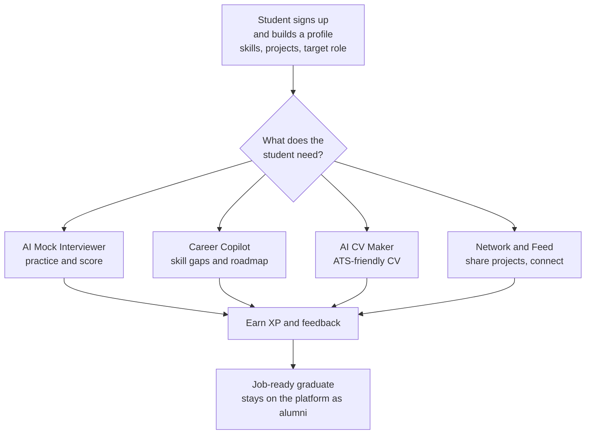
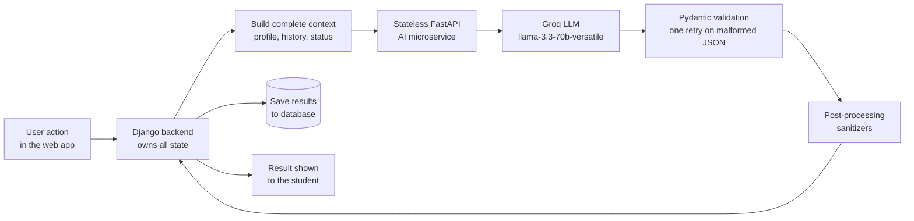
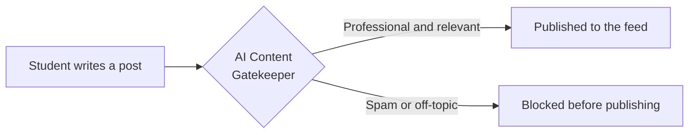

# 🚀 Syncus

**An AI-powered career and technical-community platform for university students, built to close the gap between what graduates learn and what the tech job market demands.**

Syncus acts as a digital career and technical advisor for every student: it prepares them for interviews, analyzes skill gaps, generates ATS-friendly CVs, and connects students, faculty, and alumni in one professional environment, with no extra operational load on the university.

> > > **Status:** MVP / prototype. Not deployed to production due to limited funding. The core AI tools (Mock Interviewer, Career Copilot, CV Maker) work end-to-end in the development environment.
> Originally proposed to **King Salman International University (KSIU)** as a platform to improve employability and the university's technical ecosystem.

> **My role:** AI backend engineering and product decisions: LLM workflows, structured-output validation, and the AI microservices behind the platform.

---

## 📌 Table of Contents

- [The Problem](#-the-problem)
- [Features](#-features)
- [How It Works (Flowcharts)](#-how-it-works)
- [Architecture](#-architecture)
- [AI Engineering Highlights](#-ai-engineering-highlights)
- [Product Decisions](#-product-decisions-friction--solution)
- [Screenshots](#-screenshots)
- [Tech Stack](#-tech-stack)
- [Roadmap](#-roadmap)
- [Team](#-team)

---

## ❗ The Problem

Graduate employment is one of the key measures of a university's effectiveness, yet the gap between academic learning and real market demand keeps widening.

- Graduates often fail technical interviews or ATS resume screening, usually because they never practiced that type of evaluation.
- Graduation teams are formed by friendship, not by complementary skills, which produces unbalanced projects.
- Faculty have no easy way to find students with both the right skills and genuine interest in a research topic.
- Students have no single technical space to share projects and knowledge, so they fall back on noisy social groups.
- Universities lose contact with graduates right after graduation.
- Career fairs last a single day, with students lining up at companies that don't match their skills.

## ✨ Features

### Available

| Tool | What it does |
|---|---|
| 🎤 **AI Mock Interviewer** | Practice a real technical interview with an AI interviewer tailored to your target role and get an instant performance score |
| 🧭 **Career Copilot** | A 24/7 AI mentor: skill-gap analysis against your target role, a personalized learning roadmap, and resume feedback |
| 📄 **AI CV Maker** | Generates a professional, ATS-friendly resume from your profile data, skills, and projects (PDF export) |

### Coming soon

| Tool | What it does |
|---|---|
| 🤝 **Teammate Matchmaker** | Recommends graduation-project partners based on real skill compatibility, not just who you already know |
| 🔬 **Research Team Matcher** | For faculty: describe a research project and get the top 5 students with the right skills and interest |
| 🧠 **AI Feed Recommender** | A feed that surfaces projects and posts relevant to your exact field of study |
| 📊 **AI Project Review** | Publish a project and get instant feedback on its strengths and weaknesses |

### Platform features

- 👥 **Network & messaging** between students, faculty, and alumni
- 🎓 **Student life** and 💼 **Career Fair** sections
- 🏅 **XP / points system** that rewards interview practice, CV updates, and helping peers
- 🛡 **AI Content Gatekeeper** that reviews posts before publishing to keep the space professional and spam-free
- 🔔 **Notifications**, including inactivity nudges from the Career Copilot

---

## 🔄 How It Works

### 1) Student journey

### 2) AI request flow (stateless microservices)

### 3) Content moderation

---

## 🏗 Architecture

Syncus separates **state** from **intelligence**:

- **Django** owns all state (users, profiles, history, progress) and sends the *complete context* with every AI request.
- **AI engines** are independent, **stateless FastAPI microservices**, so each one can be tested, scaled, and replaced on its own.
- Each engine ships with a **Streamlit testing UI** for rapid iteration.

| Component | Responsibility |
|---|---|
| **Web app (frontend)** | Student, faculty, and alumni interface |
| **Django backend** | Auth, data, business logic, notifications, PDF generation |
| **AI microservices (FastAPI)** | Mock Interviewer, Career Copilot, Teammate Matchmaker, Community Feed Recommender |
| **LLM provider** | Groq, `llama-3.3-70b-versatile` |

---

## 🧠 AI Engineering Highlights

- **Structured, validated outputs:** every engine validates LLM output against a Pydantic schema, retries once on malformed JSON, and applies defensive post-processing sanitizers, so the frontend always receives a predictable shape.
- **Status-aware Career Copilot:** prompts adapt to the user's state (new plan, on track, or slacking), producing a `coach_message` and a capped learning roadmap.
- **Engagement loop:** a scheduled management command sends weekly inactivity notifications.
- **CV generation:** a ReportLab-based PDF generator produces ATS-friendly resumes from profile data.
- **Secrets management:** API keys are loaded from environment variables, never committed.

---

## 🎯 Product Decisions: Friction → Solution

| Friction observed | What we built |
|---|---|
| LLM output sometimes breaks the frontend (malformed JSON) | Pydantic schemas, one automatic retry, and sanitizers on every AI engine |
| Generic advice ignores where the student is in their journey | Career Copilot adapts to user status (new plan / on track / slacking) and returns a `coach_message` |
| Long AI roadmaps overwhelm users | Roadmap length is capped so the plan stays actionable |
| Students sign up once and disappear | XP rewards plus a weekly inactivity notification job |
| Moderating a community needs human reviewers | AI Content Gatekeeper reviews posts before they are published |
| AI logic tangled with app state, hard to iterate | Stateless AI microservices; Django owns state and sends full context per request |

---

## 🖼 Screenshots

### AI Tools

### AI Mock Interviewer

### Career Copilot

---

## 🛠 Tech Stack

| Area | Tools |
|---|---|
| **Backend** | Python, Django |
| **AI services** | FastAPI, Pydantic, Streamlit (test UIs) |
| **LLM** | Groq API (`llama-3.3-70b-versatile`) |
| **Documents** | ReportLab (PDF) |
| **Frontend** | Angular |

---

## 🗺 Roadmap

- [x] AI Mock Interviewer
- [x] Career Copilot
- [x] AI CV Maker
- [ ] Teammate Matchmaker (UI integration)
- [ ] Research Team Matcher
- [ ] AI Feed Recommender (UI integration)
- [ ] AI Project Review
- [ ] Career Fair partnerships with continuous year-round listings
- [ ] Alumni career-path tracking
- [ ] Production deployment

---

## 👥 Team

| Name | Role |
|---|---|
| **Kareem Ahmed** | AI Backend Engineer: AI engines, LLM integration, Django AI apps |
| **Mohamed Ali Shawki** | Lead Software Engineer: Django backend, frontend |

---

## 📄 Note

This repository is a documentation showcase created in October 2026. The project has been developed since 06/2026, and the source code is maintained privately by the project team.
